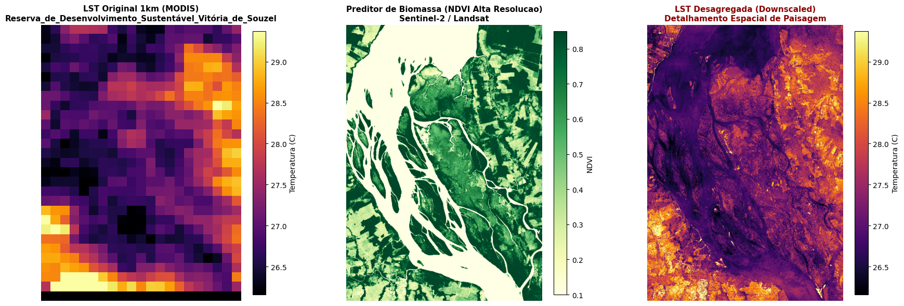
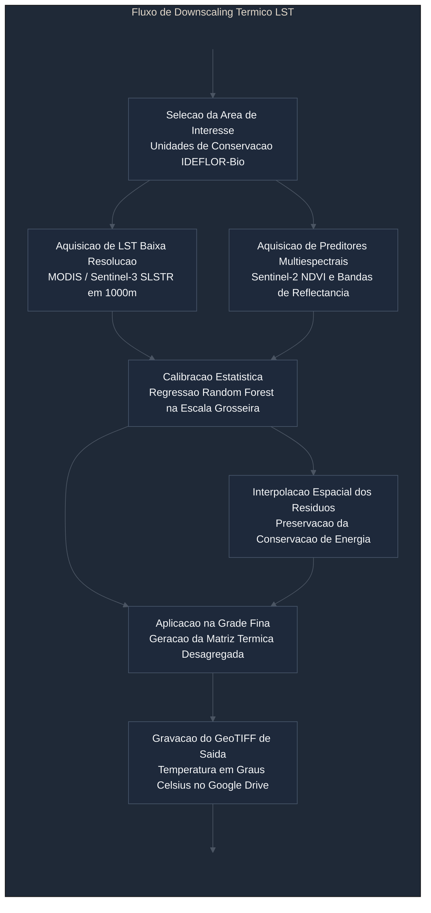

# satellite-lst-downscaler

<p align="center">
  <a href="https://colab.research.google.com/github/samuel-c-santos/satellite-lst-downscaler/blob/main/LST_Downscaling_IDEFLORBio_Colab.ipynb" target="_blank">
    
  </a>
</p>

Ambiente de **downscaling térmico (Thermal Sharpening)** e desagregação espacial da Temperatura da Superfície Terrestre (LST) para análise de microclima, gradiente térmico de paisagem e resiliência florestal em Unidades de Conservação e áreas protegidas do Estado do Pará (IDEFLOR-Bio).

---

## Demonstração Visual

<p align="center">
  
</p>

> **Figura**: Desagregação térmica na **Reserva de Desenvolvimento Sustentável (RDS) Vitória de Souzel / PA**:
> 1. **Esquerda (LST Bruta 1 km - MODIS)**: Bloco térmico quilométrico original, pixelado e incapaz de captar heterogeneidades locais.
> 2. **Centro (Preditor de Biomassa NDVI - Sentinel-2)**: Detalhamento espectral a 10-30 metros, mapeando o contraste entre a matriz florestal, ilhas fluviais e áreas antrópicas.
> 3. **Direita (LST Desagregada - Downscaled)**: Temperatura de superfície refinada na escala de paisagem, evidenciando o amortecimento térmico em matas ciliares e o aquecimento em zonas de borda e solo exposto, com conservação estrita da energia radiativa original.

---

## 1. Visão Geral

Sensores termais orbitais de alta frequência temporal, como MODIS e Sentinel-3 SLSTR, fornecem observações diárias de Temperatura da Superfície Terrestre (LST), porém em resolução espacial quilométrica (1.000 metros por pixel). Essa escala é insuficiente para a caracterização de heterogeneidades na vegetação, zonas de borda de florestas e estresse hídrico local.

Este projeto disponibiliza um fluxo reprodutível de **Thermal Sharpening** baseado no trabalho de Panagiotis Sismanidis (*downscale-satelliteLST*). O método correlaciona os dados térmicos de baixa resolução com preditores multiespectrais de alta resolução espacial (índices de vegetação como NDVI e bandas de reflectância do Sentinel-2 ou Landsat), aplicando ajuste por **Random Forest** e preservação do balanço de resíduos espaciais.



---

## 2. Camadas Geoespaciais Disponíveis

O repositório disponibiliza dados vetoriais institucionais de áreas de atuação do Instituto de Desenvolvimento Florestal e da Biodiversidade do Estado do Pará (IDEFLOR-Bio):

* `ucs_estaduais.geojson`: Limites oficiais das 29 Unidades de Conservação Estaduais sob gestão do IDEFLOR-Bio (Parque Estadual do Utinga, ESEC Grão-Pará, Flota Trombetas, RDS Vitória de Souzel, entre outras).
* `concessoes_florestais_ideflor.geojson`: Delimitações das 11 áreas de Concessões Florestais públicas ativas.
* `contratos_de_transicao.geojson`: 43 polígonos de áreas sob regime de contrato de transição florestal.
* `centro_treinamento.geojson`: Delimitação do Centro de Treinamento Agroflorestal do IDEFLOR-Bio.

---

## 3. Fundamento Metodológico

O downscaling estatístico é formulado através da relação empírica entre a temperatura de superfície e índices espectrais sensíveis à fração de cobertura vegetal e teor de umidade:

$$\text{LST}_{\text{fina}} = f(\text{Preditores}_{\text{finos}}) + \Delta\text{LST}_{\text{interpolado}}$$

1. **Amostragem**: Os preditores de alta resolução são reamostrados para a grade grosseira de 1.000 metros.
2. **Treinamento**: Um estimador de florestas aleatórias (Random Forest) ajusta a função de correlação na baixa resolução.
3. **Resíduos**: Calcula-se a diferença entre o dado observado pelo sensor térmico e a predição do modelo estatístico.
4. **Desagregação**: A função calibrada é aplicada sobre a matriz multiespectral de alta resolução espacial, adicionando-se a matriz de resíduos interpolada suavemente para assegurar a conservação estrita do gradiente térmico original.

---

## 4. Requisitos e Instalação

Para execução remota no Google Colab, recomenda-se selecionar o ambiente de execução padrão. O processamento opera com eficiência em processador central (CPU) ou acelerador gráfico (GPU).

As principais dependências do fluxo são:

```bash
pip install geemap earthengine-api geopandas rasterio scikit-learn scipy matplotlib ipywidgets
```

A autenticação no Google Earth Engine requer a utilização de um projeto ativo na Google Cloud Platform (ex: `sentinel-landsat-download`).

---

## 5. Instruções de Uso

1. Abrir o caderno [`LST_Downscaling_IDEFLORBio_Colab.ipynb`](LST_Downscaling_IDEFLORBio_Colab.ipynb) no Google Colab através do botão no topo.
2. Inicializar a sessão e confirmar a autenticação no Earth Engine e montagem do Google Drive em `/content/drive`.
3. Selecionar no menu interativo a camada de interesse e o alvo desejado (Unidade de Conservação Estadual, Concessão Florestal ou Shapefile customizado).
4. Clicar em **Confirmar Área de Estudo**.
5. Ajustar a janela temporal de interesse, priorizando meses com menor cobertura de nuvens na Amazônia (ex: agosto a novembro).
6. Executar o fluxo automatizado de aquisição dos rasters e calibração estatística do modelo.
7. Analisar os gráficos comparativos de LST bruta, NDVI e LST desagregada, coletando o arquivo GeoTIFF resultante gravado no Google Drive.

---

## 6. Referências

* Repositório base de downscaling térmico: https://github.com/pansism/downscale-satelliteLST
* Catálogo Copernicus Sentinel e coleções MODIS: Agência Espacial Europeia e NASA/USGS
* Plataforma Google Earth Engine: Google LLC
* Dados geoespaciais e vetoriais: IDEFLOR-Bio (Estado do Pará)
