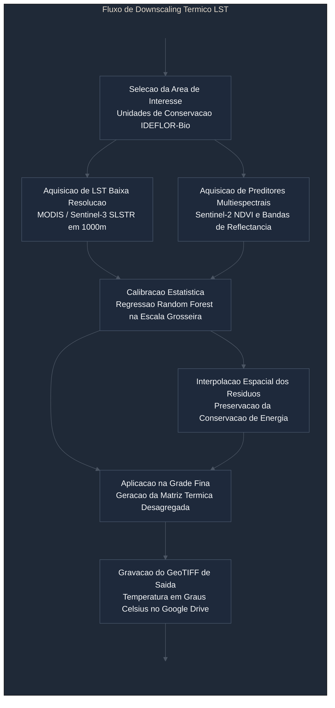

# satellite-lst-downscaler

Ambiente de downscaling termico e desagregacao espacial da Temperatura da Superficie Terrestre (LST) para analise de microclima e resiliencia florestal em Unidades de Conservacao e areas protegidas do Estado do Para.

## 1. Visao Geral

Sensores termais orbitais de alta frequencia temporal, como MODIS e Sentinel-3 SLSTR, fornecem observacoes diarias de Temperatura da Superficie Terrestre (LST), porem em resolucao espacial quilometrica (1000 metros por pixel). Essa escala e insuficiente para a caracterizacao de heterogeneidades na vegetacao, zonas de borda de florestas e estresse hidrico local.

Este projeto disponibiliza um fluxo reprodutivel de Thermal Sharpening baseado no trabalho de Panagiotis Sismanidis (downscale-satelliteLST). O metodo correlaciona os dados termicos de baixa resolucao com preditores multiespectrais de alta resolucao espacial (indices de vegetacao como NDVI e bandas de reflectancia do Sentinel-2 ou Landsat), aplicando ajuste por Random Forest e preservacao do balanco de residuos espaciais.



## 2. Camadas Geoespaciais Disponiveis

O repositorio disponibiliza dados vetoriais institucionais de areas de atuacao do Instituto de Desenvolvimento Florestal e da Biodiversidade do Estado do Para (IDEFLOR-Bio):

* `ucs_estaduais.geojson`: Limites oficiais das 29 Unidades de Conservacao Estaduais sob gestao do IDEFLOR-Bio (Parque Estadual do Utinga, ESEC Grao-Para, Flota Trombetas, entre outras).
* `concessoes_florestais_ideflor.geojson`: Delimitacoes das 11 areas de Concessoes Florestais publicas ativas.
* `contratos_de_transicao.geojson`: 43 poligonos de areas sob regime de contrato de transicao florestal.
* `centro_treinamento.geojson`: Delimitacao do Centro de Treinamento Agroflorestal do IDEFLOR-Bio.

## 3. Fundamento Metodologico

O downscaling estatistico e formulado atraves da relacao empirica entre a temperatura de superficie e indices espectrais sensiveis a fracao de cobertura vegetal e teor de umidade:

1. **Amostragem**: Os preditores de alta resolucao sao reamostrados para a grade grosseira de 1000 metros.
2. **Treinamento**: Um estimador de florestas aleatorias (Random Forest) ajusta a funcao de correlacao na baixa resolucao.
3. **Residuos**: Calcula-se a diferenca entre o dado observado pelo sensor termico e a predicao do modelo estatistico.
4. **Desagregacao**: A funcao calibrada e aplicada sobre a matriz multiespectral de alta resolucao espacial, adicionando-se a matriz de residuos interpolada suavemente para assegurar a conservacao do gradiente termico original.

## 4. Requisitos e Instalacao

Para execucao remota no Google Colab, recomenda-se selecionar o ambiente de execucao padrao. O processamento opera com eficiencia em processador central (CPU) ou acelerador grafico (GPU).

As principais dependencias do fluxo sao:

```bash
pip install geemap earthengine-api geopandas rasterio scikit-learn scipy matplotlib ipywidgets
```

A autenticacao no Google Earth Engine requer a utilizacao de um projeto ativo na Google Cloud Platform. O projeto configurado no caderno e `sentinel-landsat-download`.

## 5. Instrucoes de Uso

1. Abrir o caderno `LST_Downscaling_IDEFLORBio_Colab.ipynb` no Google Colab atraves do botao no cabecalho.
2. Inicializar a sessao e confirmar a montagem do Google Drive em `/content/drive`.
3. Selecionar no menu interativo a camada de interesse e o alvo desejado (Unidade de Conservacao Estadual ou Concessao Florestal).
4. Ajustar a janela temporal de interesse, priorizando meses com menor cobertura de nuvens.
5. Executar o fluxo automatizado de aquisicao dos rasters e calibracao estatistica do modelo.
6. Analisar os graficos comparativos de LST bruta, NDVI e LST desagregada, coletando o arquivo GeoTIFF resultante no Google Drive.

## 6. Referencias

* Repositorio base de downscaling termico: https://github.com/pansism/downscale-satelliteLST
* Catalogo Copernicus Sentinel e colecoes MODIS: Agencia Espacial Europeia e NASA/USGS
* Plataforma Google Earth Engine: Google LLC
* Dados geoespaciais e vetoriais: IDEFLOR-Bio (Estado do Para)
